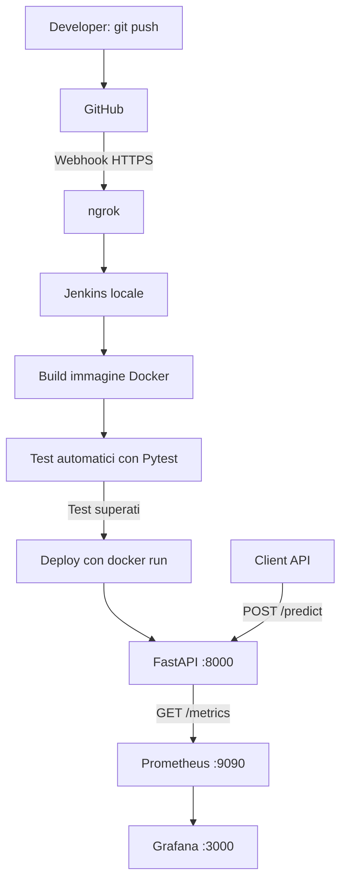
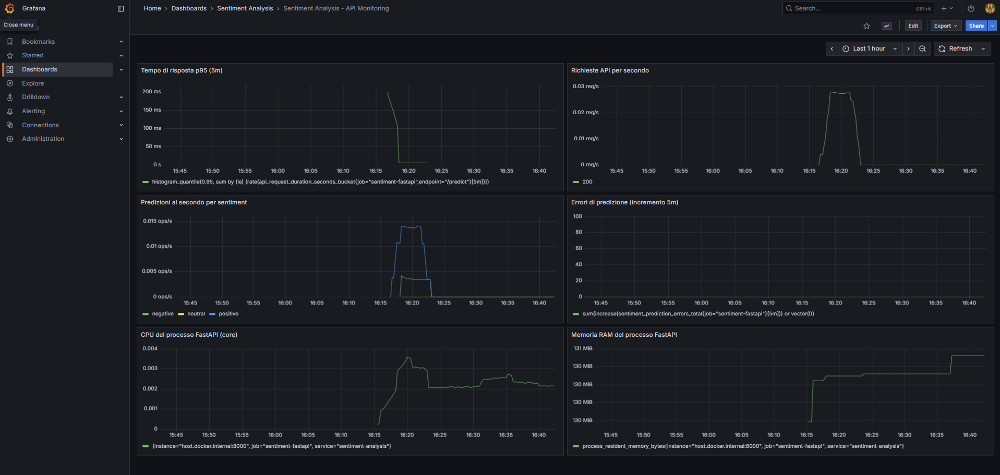
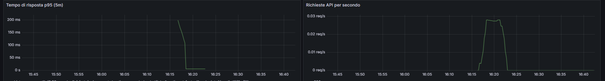
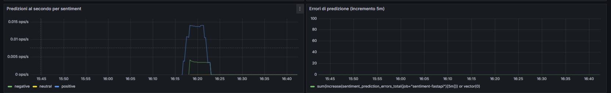
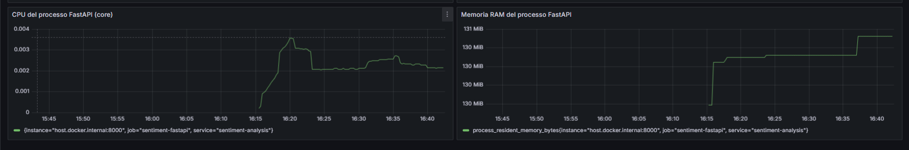
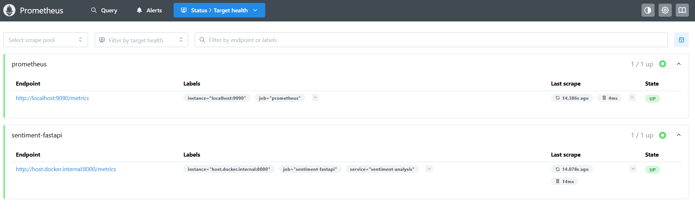

# Sentiment Analysis – DevOps CI/CD & Monitoring

Progetto DevOps per rendere disponibile tramite API REST un modello di **Sentiment Analysis** già addestrato, automatizzarne i test e il rilascio con **Jenkins**, e monitorarne il funzionamento con **Prometheus** e **Grafana**.

Il modello analizza recensioni di prodotti in lingua inglese e restituisce il sentimento previsto e il relativo valore di confidenza. **Il progetto non prevede l'addestramento del modello**, ma la sua integrazione in un servizio deployabile e osservabile.

## 1. Tecnologie

| Tecnologia | Ruolo |
| --- | --- |
| Python 3.12 | Linguaggio applicativo nel container |
| FastAPI + Uvicorn | API REST |
| Pickle | Caricamento del modello già addestrato |
| Pytest | Test automatici |
| Docker | Build ed esecuzione del servizio |
| Jenkins | Pipeline CI/CD |
| GitHub + Webhook | Versionamento e trigger della pipeline |
| ngrok | Esposizione temporanea di Jenkins in locale per ricevere i webhook |
| Prometheus | Raccolta delle metriche |
| Grafana | Dashboard di monitoraggio |

## 2. Architettura



**Scelta architetturale:** il container FastAPI è costruito e avviato direttamente dal `Jenkinsfile` con i comandi Docker. `compose.monitoring.yaml` gestisce **solo Prometheus e Grafana**.

```text
SentimentAnalysisDevOps/
├── progetto.py                           # API FastAPI, health check e metriche
├── sentiment_analysis_model.pkl          # Modello ML già addestrato
├── requirements.txt                      # Dipendenze Python
├── Dockerfile                            # Container dell'applicazione
├── Jenkinsfile                           # Pipeline CI/CD
├── compose.monitoring.yaml               # Prometheus e Grafana
├── models/
│   ├── metrics.py                        # Definizione delle metriche
│   └── sentiment_analisys.py             # Modelli dati API
├── tests/
│   ├── test_validation.py
│   ├── test_predict.py
│   └── test_metrics.py
├── monitoring/
│   ├── prometheus/prometheus.yml
│   └── grafana/
│       ├── dashboards/sentiment-overview.json
│       └── provisioning/
│           ├── dashboards/dashboards.yml
│           └── datasources/prometheus.yml
└── README.md
```

## 4. Prerequisiti

Per l'ambiente locale descritto in questo progetto:

- Git e accesso al repository GitHub.
- Docker Desktop avviato (con motore Docker funzionante).
- Jenkins installato e raggiungibile localmente, con accesso ai comandi Docker.
- ngrok installato e configurato per esporre Jenkins a GitHub.
- Python e pip, **solo** se si vuole eseguire l'applicazione e i test senza Docker.

La pipeline usa gli step Jenkins `bat` e `powershell`: **è predisposta per un agente Jenkins Windows**. Per agent Linux occorre sostituire tali step con i comandi appropriati (`sh`).

## 5. Avvio dell'API

### Opzione A – Docker (consigliata)

Dalla cartella principale del repository:

```bash
docker build -t sentiment-analysis:local .
docker run -d --name sentiment-analysis -p 8000:8000 sentiment-analysis:local
```

L'API sarà disponibile su:

- Documentazione interattiva Swagger: <http://localhost:8000/docs>
- Health check: <http://localhost:8000/health>
- Metriche: <http://localhost:8000/metrics>

Controllo dello stato:

```bash
docker ps
docker logs sentiment-analysis
```

Per arrestare e rimuovere il container:

```bash
docker rm -f sentiment-analysis
```

> Se il container `sentiment-analysis` è già stato creato da Jenkins, evitare di avviare una seconda istanza con lo stesso nome o sulla stessa porta.

### Opzione B – Esecuzione Python senza Docker

```bash
python -m venv .venv
```

Attivare l'ambiente virtuale:

```powershell
# Windows PowerShell
.venv\Scripts\Activate.ps1
```

```bash
# Linux/macOS
source .venv/bin/activate
```

Installare le dipendenze ed eseguire l'API:

```bash
pip install -r requirements.txt
uvicorn progetto:app --host 127.0.0.1 --port 8000
```

Il modello `sentiment_analysis_model.pkl` deve essere presente nella directory del progetto. Caricare file pickle **solo da fonti affidabili**, perché la deserializzazione può eseguire codice.

## 6. API REST

### `POST /predict`

Accetta una recensione in inglese e restituisce il sentimento classificato e il valore di confidenza.

**Richiesta:**

```http
POST /predict
Content-Type: application/json
```

```json
{
  "review": "This product is amazing! I love it."
}
```

**Risposta – esempio illustrativo (valori effettivi dipendenti dal modello):**

```json
{
  "sentiment": "positive",
  "confidence": 0.95
}
```

Esempio da PowerShell:

```powershell
Invoke-RestMethod -Uri "http://localhost:8000/predict" `
  -Method Post `
  -ContentType "application/json" `
  -Body '{"review":"This product is amazing! I love it."}'
```

Una recensione vuota o composta da soli spazi genera una risposta HTTP `400`. L'assenza del campo obbligatorio `review` produce un errore di validazione HTTP `422` gestito da FastAPI.

### `GET /health`

Endpoint utilizzato anche dalla pipeline Jenkins per verificare che il container sia operativo:

```text
http://localhost:8000/health
```

### `GET /metrics`

Espone le metriche in formato Prometheus:

```text
http://localhost:8000/metrics
```

## 7. Test automatici

Il repository include test di validazione, predizione e metriche:

```bash
python -m pytest -v tests/
```

Gli stessi test sono eseguiti dalla pipeline all'interno dell'immagine Docker:

```bash
docker run --rm sentiment-analysis:local python -m pytest -v tests/
```

Se i test falliscono, Jenkins interrompe l'esecuzione e **non passa al deploy**.

## 8. Jenkins e deploy automatico

Il file `Jenkinsfile` definisce i seguenti stadi:

| Stage | Attività |
| --- | --- |
| Checkout | Recupera il codice del repository |
| Build Docker | Crea l'immagine `sentiment-analysis:<numero-build>` |
| Test | Esegue Pytest nel container temporaneo |
| Deploy | Rimuove il container precedente e avvia quello nuovo sulla porta 8000 |
| Health Check | Interroga `/health` con tentativi di retry |

Il deploy è realizzato con `docker run`, **senza Docker Compose**. La sezione `post` del Jenkinsfile riporta nella console di Jenkins l'esito `SUCCESS` o `FAILURE`. In questa versione dimostrativa **non sono configurate notifiche esterne** (email o Slack).

### Trigger automatico GitHub tramite ngrok

Nella configurazione attuale, Jenkins è eseguito in locale ed è esposto verso GitHub con un tunnel HTTPS ngrok.

1. Avviare Jenkins e Docker Desktop.
2. Avviare il tunnel ngrok verso la porta locale utilizzata da Jenkins (ad esempio `ngrok http 8080`, se Jenkins è sulla porta 8080).
3. Configurare nel repository GitHub, in **Settings → Webhooks**, l'URL HTTPS pubblico del tunnel con il percorso webhook richiesto dall'integrazione Jenkins (tipicamente `/github-webhook/`).
4. Impostare il webhook per gli eventi di `push` e verificare che il job Jenkins sia configurato per riceverli.
5. Eseguire una modifica, creare un commit e fare `git push`.
6. Verificare nell'interfaccia Jenkins l'avvio automatico e l'esito della pipeline.

Esempio **puramente indicativo** di Payload URL:

```text
https://<dominio-ngrok>/github-webhook/
```

**Nota:** il tunnel deve rimanere attivo e, se cambia l'URL pubblico, occorre aggiornare il webhook GitHub. Non esporre Jenkins senza autenticazione e adeguate protezioni.

## 9. Monitoraggio Prometheus e Grafana

### 9.1 Avvio dello stack

Il monitoraggio viene avviato separatamente dall'applicazione:

```bash
docker compose -f compose.monitoring.yaml up -d
```

Prima dell'avvio, creare nella root del progetto un file `.env` **non versionato** con una password scelta per Grafana:

```dotenv
GRAFANA_ADMIN_PASSWORD=SOSTITUIRE_CON_PASSWORD_SICURA
```

Il file `compose.monitoring.yaml` richiede questa variabile e usa i servizi:

| Servizio | Indirizzo locale | Scopo |
| --- | --- | --- |
| FastAPI | <http://localhost:8000> | Applicazione |
| Prometheus | <http://localhost:9090> | Raccolta metriche |
| Grafana | <http://localhost:3000> | Dashboard |

Grafana usa l'utente `admin` e la password impostata in `.env`.

### 9.2 Raccolta delle metriche

Prometheus interroga periodicamente `/metrics` ogni **15 secondi**. La configurazione è nel file:

```text
monitoring/prometheus/prometheus.yml
```

Il target dell'applicazione è:

```text
host.docker.internal:8000
```

Questa configurazione è pensata per Docker Desktop. Su Linux può richiedere un mapping specifico del gateway dell'host o una rete Docker differente.

Le metriche applicative includono:

| Metrica | Descrizione |
| --- | --- |
| `api_requests_total` | Numero di richieste per metodo, endpoint e codice HTTP |
| `api_request_duration_seconds` | Durata delle richieste |
| `sentiment_predictions_total` | Predizioni effettuate suddivise per sentiment |
| `sentiment_prediction_errors_total` | Errori durante la predizione |
| `process_cpu_seconds_total` | Tempo CPU cumulato del processo |
| `process_resident_memory_bytes` | Memoria residente del processo |

Le ultime due appartengono alle metriche di processo esposte dal client Prometheus Python, nell'ambiente in cui sono disponibili.

Per verificare lo scraping, aprire la pagina dei target di Prometheus:

```text
http://localhost:9090/targets
```

Il target `sentiment-fastapi` deve risultare `UP`.

### 9.3 Dashboard Grafana

La dashboard è definita nel repository:

```text
monitoring/grafana/dashboards/sentiment-overview.json
```

Grafana carica automaticamente datasource e dashboard dalle directory di provisioning già configurate. La dashboard **Sentiment Analysis - API Monitoring** contiene pannelli dedicati a:

- Tempo di risposta p95 (ultimi 5 minuti).
- Richieste API al secondo.
- Predizioni al secondo suddivise per sentiment.
- Errori di predizione negli ultimi 5 minuti.
- Utilizzo CPU del processo FastAPI.
- Memoria RAM del processo FastAPI.

Per generare dati da visualizzare, inviare alcune richieste a `POST /predict`, poi consultare Grafana. Potrebbero servire alcuni intervalli di scraping prima che i grafici mostrino campioni significativi.

## 10. Screenshot del monitoraggio

Questa sezione documenta il funzionamento reale delle dashboard.

### 10.1 Panoramica dashboard Grafana



### 10.2 Latenza e traffico delle API



### 10.3 Predizioni ed errori



### 10.4 Utilizzo CPU e memoria



### 10.5 Verifica target Prometheus (opzionale)



## 11. Troubleshooting

| Problema | Verifica / soluzione |
| --- | --- |
| Jenkins non parte al `push` | Controllare che ngrok sia attivo, il Payload URL del webhook e la consegna dell'evento GitHub |
| `docker build` fallisce | Controllare Docker Desktop, `Dockerfile` e dipendenze Python |
| I test falliscono | Leggere il log dello stage `Test` in Jenkins e riprodurre con `python -m pytest -v tests/` |
| API non raggiungibile | Eseguire `docker ps`, `docker logs sentiment-analysis` e verificare la porta 8000 |
| Health Check Jenkins fallisce | Controllare la risposta di `/health` e i log del container |
| Prometheus mostra target `DOWN` | Verificare che FastAPI sia in esecuzione e che `host.docker.internal:8000` sia raggiungibile dal container Prometheus |
| Grafana non mostra dati | Verificare `/targets`, inviare richieste a `/predict` e controllare il datasource Prometheus |
| Grafana non parte | Verificare che `GRAFANA_ADMIN_PASSWORD` sia impostata nel file `.env` |
| Grafana non mostra dashboard | Controllare i file JSON e il provisioning sotto `monitoring/grafana/` |

Log dei servizi di monitoraggio:

```bash
docker compose -f compose.monitoring.yaml logs -f
```

Arresto del monitoraggio (conservando i dati nei volumi):

```bash
docker compose -f compose.monitoring.yaml down
```

## 12. Sicurezza e limiti dell'ambiente dimostrativo

- Le credenziali non devono essere inserite nel repository: il file `.env` è escluso tramite `.gitignore`.
- La pipeline attuale è pensata per un ambiente locale/dimostrativo, non per un deploy zero-downtime: durante la sostituzione del container può esserci una breve indisponibilità.
- `ngrok` rende raggiungibile Jenkins dall'esterno; l'accesso deve essere protetto e il tunnel va attivato solo quando necessario.
- Il modello pickle deve provenire da una fonte affidabile.
- Le metriche CPU/RAM monitorano il **processo applicativo**, non l'intero host Docker.
- Le notifiche della pipeline sono messaggi nella console Jenkins; non è implementato l'invio a servizi esterni.

## 13. Verifica completa del flusso

Per dimostrare il funzionamento end-to-end:

1. Avviare Docker Desktop, Jenkins e ngrok.
2. Avviare Prometheus e Grafana con Docker Compose.
3. Eseguire un commit e un `git push` su GitHub.
4. Verificare la ricezione del webhook e l'avvio automatico della pipeline Jenkins.
5. Controllare il completamento degli stage e del `Health Check`.
6. Inviare una richiesta a `POST /predict` e controllarne la risposta.
7. Verificare in Prometheus il target `sentiment-fastapi` in stato `UP`.
8. Aprire Grafana e controllare che traffico, latenza, predizioni e utilizzo risorse siano visualizzati.
9. Acquisire gli screenshot e inserirli nella sezione **Screenshot del monitoraggio**.

---

## 14. Link al repository GitHub

https://github.com/alessandra-a11y/SentimentAnalysisDevOps.git